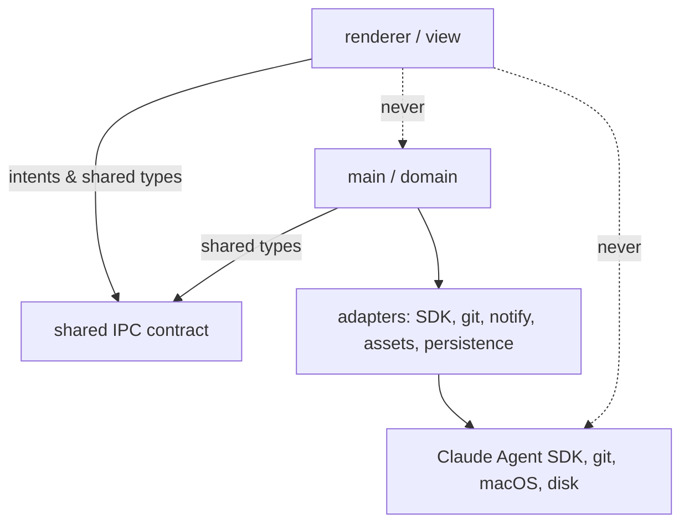
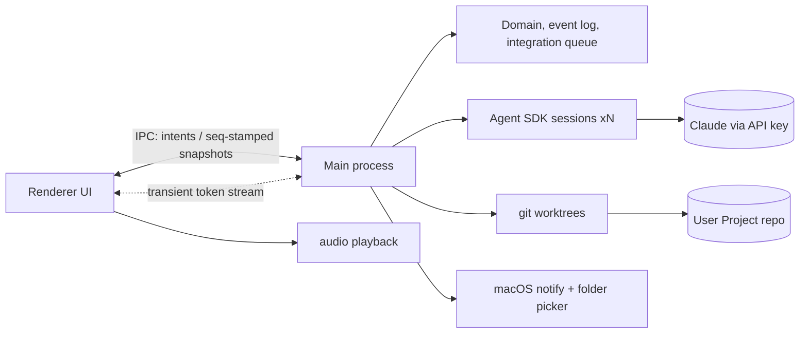

# Architecture Spine — Bikini Bottom

## Design Paradigm

**The main process is the town; the renderer is the stage.** One authoritative Electron **main process** owns all truth — Lane sessions, Jobs, States, the Orders Board, the Project git repo, the filesystem, audio cues and notifications. The **renderer** (the bespoke hand-drawn UI from DESIGN.md) holds *no* business state: it renders snapshots pushed to it and sends **intents** back (`handOutJob`, `openLane`, `answerPermission`, `sendItBack`, `cancelOrder`, `markSeen`). State change is an **append-only, single-writer, totally-ordered event log** in main, from which the snapshot is derived and persisted — this is what makes "nothing that needs Maksym is ever missable" and "survives quit/crash/sleep" (PRD §9) structural, not best-effort.

| Layer | Lives in | Owns |
| --- | --- | --- |
| View | `src/renderer/` | DOM, animations, sound playback; only ephemeral render state |
| IPC contract | `src/shared/` | Typed intent + snapshot + event shapes (the sole cross-boundary vocabulary) |
| Domain | `src/main/domain/` | Job/Lane state machine, event log, snapshot fold, integration queue |
| Adapters | `src/main/adapters/` | Agent SDK, git, notifications, asset resolution, persistence |

## Invariants & Rules

### AD-1 — Main is the single source of truth, with one declared exception [ADOPTED]
- **Binds:** all
- **Prevents:** renderer and main disagreeing about a Character's State; state lost on window close; two stores of the same fact.
- **Rule:** All Job/Lane/State/Order **domain** data lives in main and is persisted there; the renderer derives nothing it isn't handed and never touches fs/git/SDK directly. **Exception:** a Lane's Claude SDK session transcript is the chat-log-of-record for that Lane (main does not re-store token content); the event log holds domain facts and per-turn summaries that *reference* it.

### AD-2 — One serialized writer, total order, side-effect-free replay
- **Binds:** domain, persistence
- **Prevents:** concurrent Lanes corrupting the log; a restarted snapshot differing from the live one; launch re-firing past voices/notifications.
- **Rule:** A single writer in main appends every event; each event carries a monotonic `seq` and is persisted **before** its effect is acknowledged. The snapshot is a pure fold over events ordered by `seq`. **Replay on boot derives snapshot only — it fires no side effects;** voices, notifications and integrations happen solely on *live* transitions. Event vocabulary includes `JobHandedOut`, `LaneStartedWorking`, `PermissionAsked`, `PermissionAnswered`, `JobServed`, `JobBurned{reason}`, `OrderSeen`, `SentBack`, `OrderScrapped`, `WatchdogStalled`.

### AD-3 — One Lane = one worktree (path-stable cwd) = one session; new Job resets, follow-up resumes
- **Binds:** Lane adapter, git adapter, SDK adapter
- **Prevents:** parallel Lanes colliding; the per-cwd resume gotcha; a new Job inheriting a stale conversation (FR-13).
- **Rule:** Each Character owns one worktree at a fixed path (`<project>/.bikini/worktrees/<character>`), used as that Lane's SDK `cwd` for its whole life so `resume` always resolves. **A new Job (`handOutJob`) starts a fresh SDK session and resets the worktree to the Project main HEAD; a follow-up resumes the current session.** The Lane adapter performs the reset on `JobHandedOut`. One active Job per Character (PRD §3).

### AD-4 — Renderer speaks intents; main replies with seq-stamped snapshots + events; streaming is a separate transient channel
- **Binds:** IPC boundary
- **Prevents:** two owners of one entity; renderer/main desync; token streaming masquerading as durable state.
- **Rule:** One typed intent channel (renderer→main) and one authoritative state channel (main→renderer) carrying snapshots and events, each stamped with `seq`; the renderer applies them **monotonically and ignores anything stale**. Live token-level output is a **separate, transient, view-only channel** — never persisted, never authoritative; if it's lost, the durable turn summary (AD-2) still lands.

### AD-5 — Serving, Send-it-back and collisions are serialized git ops, never shown as git
- **Binds:** git adapter, domain, Work Window
- **Prevents:** two simultaneous serves corrupting the main line; an unattributable Job that can't be cleanly reverted; a merge surface reaching Maksym.
- **Rule:** One **integration queue** in main owns the Project main line — serves apply one at a time. **Each Job produces exactly one squashed commit tagged with its `jobId`.** Landing = integrate that commit onto the Project's main branch. **Send it back** = revert that tagged commit. A collision offers **keep-both** when the two changes don't overlap, else **one plain either/or** side-pick ("keep {this}'s" / "keep {other}'s") — the same model covers revert-time entanglement. Never a diff/merge view (EXPERIENCE Collision choice; FR-16).

### AD-6 — Risky vs Safe is the SDK permission seam; pending asks survive relaunch
- **Binds:** SDK adapter, permission flow
- **Prevents:** constant interruptions or silent risky actions; a dead permission promise after a crash.
- **Rule:** `canUseTool` is the single seam. Reads/edits *inside the Lane's worktree* are Safe (auto-allowed); anything outside it, any network install, any destructive shell command is Risky → pauses the Lane, emits `PermissionAsked`, Character goes Calling until `PermissionAnswered`. The allow-list is one named config table. A `PermissionAsked` with no `PermissionAnswered` at boot is **re-driven** (the Lane re-issues the ask; the old promise is gone), never silently resolved.

### AD-7 — Every visual and sound resolves through the Asset Slot resolver
- **Binds:** asset adapter, renderer
- **Prevents:** hard-coded art paths; a missing file crashing a Character.
- **Rule:** One resolver maps `(character, state)` / `(character, voice)` / `background` to a user file, falling back to the labelled stand-in when absent (FR-14, FR-18). The app never fetches or generates art. Adding Sandy = files + one config row, no code (FR-2).

### AD-8 — Claude access reuses Maksym's existing Claude subscription login; API key is an optional fallback
- **Binds:** SDK adapter, config, First Run, product copy
- **Prevents:** forcing metered pay-per-use billing when the user's own subscription is already usable; a stray env key silently billing him.
- **Rule:** Primary auth is Maksym's **existing Claude Code subscription login** — the SDK spawns the bundled CLI, which uses the OAuth credentials from a prior `claude login` (no `ANTHROPIC_API_KEY`). Permitted for personal, single-user, local use (Anthropic support guidance; consistent with PRD Non-Goals: private personal tool). The app **must ensure no stray `ANTHROPIC_API_KEY` is set** (it silently wins and bills per-use). If Electron keychain access is blocked, fall back to an official `CLAUDE_CODE_OAUTH_TOKEN` from `claude setup-token` (a 1-year subscription token) — still the subscription, not metered. An explicit API key is an **optional advanced path**, never the default. First Run detects and confirms which auth is live in plain words. *(Story 1.3 must verify subscription auto-pickup and the token fallback on the real machine.)*

### AD-9 — The Project is sacred: scoped, ignored, atomic, recoverable
- **Binds:** git adapter, persistence, First Run
- **Prevents:** app machinery polluting Maksym's repo; a crash mid-serve leaving his Project broken.
- **Rule:** `.bikini/` (worktrees + event log) is git-ignored in the Project. App commits are **path-scoped to Lane work only** — never the app's own files. Every git mutation (init, worktree add, integrate, revert) is **atomic**: it fully applies or rolls back, and boot **crash-recovery** repairs a dirty index/worktree to the last consistent state. The app only ever *appends* its own tagged commits; it never rewrites Maksym's existing history.

### AD-10 — A liveness watchdog forbids the silent stall
- **Binds:** SDK adapter, domain
- **Prevents:** a Character stuck "Working" forever when the SDK stalls without throwing (FR-5).
- **Rule:** Every COOKING Lane has a heartbeat; no SDK activity past a configured timeout emits `JobBurned{reason:"stuck"}` → Character goes Calling. A Lane cannot be Working with no live progress and no path to Calling.

### AD-11 — In-flight work is conversation-resumable, not turn-resumable
- **Binds:** SDK adapter, git adapter, domain
- **Prevents:** partial/duplicate commits or a corrupt worktree after quit/crash mid-turn (PRD §9 pause-on-quit).
- **Rule:** A mid-turn Job is never resumed mid-turn. On quit/crash the worktree is left at its last committed state and the Job is marked resumable; relaunch offers "keep cooking", which re-drives the session from that last committed point. No half-turn is ever committed or double-applied.

### AD-12 — "Seen" is owned by main and only an explicit render-ack clears it
- **Binds:** IPC boundary, domain, renderer
- **Prevents:** a dot clearing though Maksym never saw the result, or never clearing because the signal was lost (SM-2).
- **Rule:** Main owns "seen". The renderer sends an **idempotent `markSeen(jobId)` intent only after it has actually rendered the resolving content** (result summary displayed, choice answered, trouble acknowledged); main then persists `OrderSeen`. **Snapshot delivery never counts as seen.** The intent is idempotent so a retry after a lost message is safe.

**Dependency direction** (arrows point to what a layer may depend on):



## Consistency Conventions

| Concern | Convention |
| --- | --- |
| Naming | Domain terms = PRD Glossary verbatim (`Lane`, `Job`, `Character`, `Calling`, `Order`, `Serving`). Events past-tense (`JobBurned`); intents imperative (`handOutJob`). |
| Data & formats | IDs opaque strings — `character` = fixed slug (`bob\|squid\|pat\|sandy\|krabs`), `jobId` = uuid; each Job's git commit is tagged with its `jobId`. Dates ISO-8601 UTC; ordering is by event `seq`, not timestamp. Every cross-boundary message is a discriminated union on a `type` field. |
| State & cross-cutting | Single event log per app install, one writer, `seq`-ordered; snapshot derived, never hand-mutated. Adapter errors are caught in main and become domain events (`JobBurned{reason}`) — raw errors never cross IPC. Config (API key, allow-list, character roster) in one typed config module. |

## Stack

| Name | Version |
| --- | --- |
| Electron | 43.1.0 |
| Node (bundled in Electron) | 24.18 |
| TypeScript | 5.x (current) |
| @anthropic-ai/claude-agent-sdk | 0.3.207 |
| Renderer | plain HTML/CSS/JS, no framework — bespoke per DESIGN.md |
| git | system git (worktrees) |
| Persistence | append-only JSON event log on disk (no DB in v1) |
| Packaging | electron-builder; code-signed + notarized for distribution/Gatekeeper (Apple Developer ID cert required) |

## Structural Seed

```text
bikini-bottom/
  src/
    main/
      domain/        # Job/Lane state machine, event log (single writer), snapshot fold, integration queue
      adapters/      # sdk/ git/ notify/ assets/ persistence/
      config/        # api key, risky/safe allow-list, character roster
      main.ts        # Electron entry, window, IPC wiring
    renderer/        # the Town, Work Window, Orders Board, First Run (DESIGN.md)
    shared/          # intent + snapshot + event type unions, all seq-stamped (the IPC contract)
  assets/            # Maksym's pictures/gifs/sounds (Asset Slots) + stand-ins
  <project>/.bikini/ # app-managed, git-ignored: worktrees/ + event-log  (AD-9)
```



## Capability → Architecture Map

| Capability / Area | Lives in | Governed by |
| --- | --- | --- |
| Town + States + Unseen Dot (FR-1..4) | renderer + domain snapshot | AD-1, AD-2, AD-7, AD-12 |
| Trouble / BURNED, incl. silent stalls (FR-5) | domain (error/watchdog→event) + Work Window | AD-2, AD-6, AD-10 |
| Voices + notifications (FR-6,7,8) | renderer (audio) + notify adapter | AD-1, AD-2, AD-7 |
| Orders Board (FR-9,10) | renderer over snapshot | AD-1, AD-4 |
| Work Window chat / folded detail (FR-11) | renderer + SDK adapter stream | AD-1, AD-4, AD-6 |
| Permission asks (FR-12) | SDK adapter `canUseTool` | AD-6 |
| Follow-ups / conversation reset (FR-13) | SDK adapter (resume vs fresh) | AD-3 |
| Cancel (FR-14) | SDK adapter `interrupt()` | AD-3, AD-4 |
| Hand out Job / picker (FR-15) | domain + Home Base window | AD-3, AD-4 |
| Serving / Send it back / collision (FR-16,17) | integration queue + git adapter | AD-5, AD-9 |
| Asset Slots + drop-in Sandy (FR-2,18) | asset adapter | AD-7 |
| First Run + Project prep (FR-19) | main setup flow + git init | AD-3, AD-8, AD-9 |
| Quit/crash survival (PRD §9) | persistence + Lane adapter | AD-2, AD-11 |

## Deferred

- **Real Voice Line audio + Sandy/Mr. Krabs pictures** — content from Maksym; placeholders (mockup synth signatures) ship first.
- **Exact Risky/Safe allow-list contents** — the *seam* is fixed (AD-6); the specific tool/path table is settled in the first permission story with Maksym's plain-language sign-off (PRD Open Q3).
- **Multi-file collision batching** — one either/or vs a short sequence when keep-both doesn't apply (AD-5); pick during the Serving story.
- **First-run folder-prep failure UX** — the safety rules are fixed (AD-9); the exact plain-language recovery scene (bad folder, permission denied) is a First-Run story detail.
- **Auto-update / distribution** — single-user local build; no updater in v1.
- **Multiple Projects, night background, wider street** — PRD v2 cuts.
- **Auth edge cases** — the model is fixed (AD-8: reuse the subscription login, fall back to a subscription token, API key optional); the real-machine verification of credential pickup and the exact First-Run wording are settled in Story 1.3.
